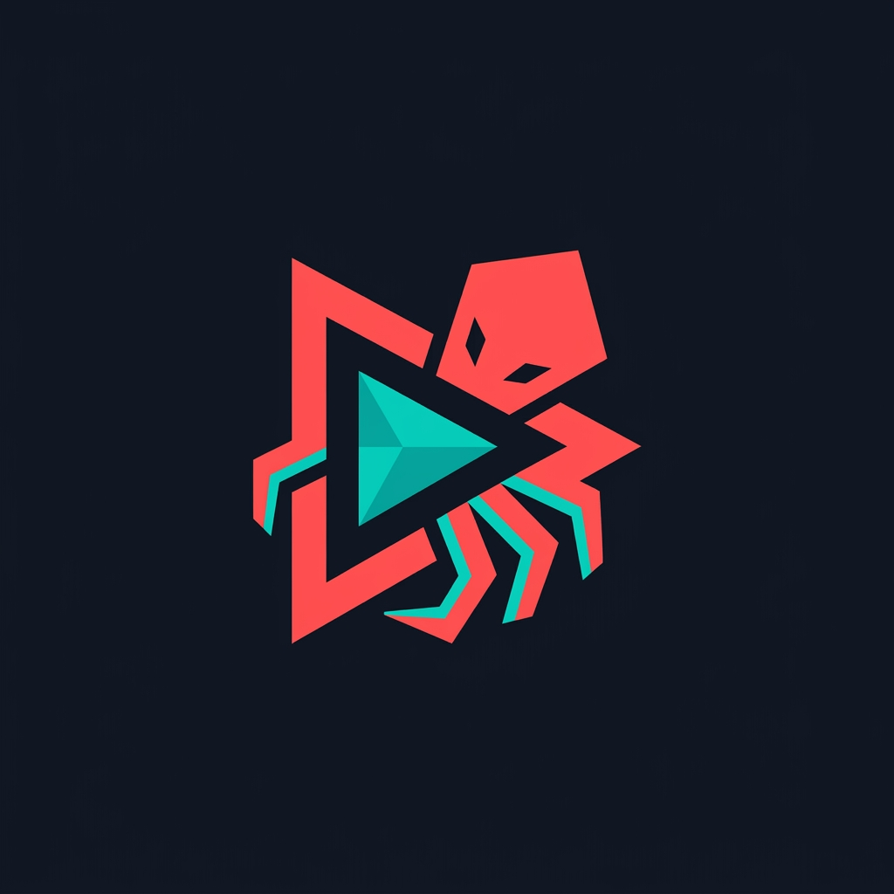

<div align="center">



# OctoTube

### Discover. Watch. Keep exploring.

An independent Android video discovery and playback client built with Kotlin and Jetpack Compose.

[Features](#features) · [Technology](#technology) · [Build](#build-from-source) · [Project status](#project-status)

</div>

---

## About the project

**OctoTube** is an Android application designed to bring video discovery, channel exploration, subscriptions, and playback together in one clean experience. It uses a modular multi-source approach, allowing supported content to be discovered through compatible community services rather than depending on a single provider.

The project is developed natively for Android with a modern Kotlin architecture and a Jetpack Compose interface. Its design direction prioritizes a responsive experience across phones and tablets, with playback treated as a persistent part of the app rather than an isolated screen.

> OctoTube is an independent, community-oriented client project. It is not affiliated with, endorsed by, or an official application of YouTube or any other content provider.

## Features

- **Multi-source discovery:** integrations for Piped, Invidious, and PeerTube extraction/catalog services.
- **Video playback:** AndroidX Media3 / ExoPlayer-based playback infrastructure, including HLS and DASH support through the relevant Media3 modules.
- **Channels and subscriptions:** browse channel content and keep track of followed channels.
- **Downloads:** download-management components and a dedicated downloads area.
- **Playback continuity:** a media playback service designed to keep playback available beyond the visible player screen.
- **Picture-in-Picture foundation:** Android activity configuration includes PiP support.
- **SponsorBlock integration:** client integration for supported SponsorBlock segment data.
- **Local persistence:** Room database and DataStore preferences for app data and settings.
- **Adaptive interface direction:** Compose-based UI with navigation layouts intended to work across different screen sizes.

Feature availability can depend on the selected provider, its current API/instance health, the media format, and the device.

## Technology

| Area | Technology |
|---|---|
| Language | Kotlin |
| UI | Jetpack Compose, Material 3 |
| Playback | AndroidX Media3 / ExoPlayer |
| Networking | OkHttp, Retrofit, Moshi |
| Local data | Room, DataStore |
| Navigation | Navigation Compose |
| Async operations | Kotlin Coroutines |
| Minimum Android version | Android 7.0 (API 24) |
| Application ID | `com.octopus.octotube` |

## Project structure

- `app/src/main/java` — application source code, UI, player, data, and networking layers.
- `app/src/main/res` — Android resources, launcher artwork, fonts, and visual assets.
- `gradle/` — Gradle wrapper configuration and dependency version catalog.

## Build from source

1. Clone the repository and open the `extracted-project` directory in Android Studio.
2. Use JDK 17 and allow Gradle sync to complete.
3. Connect an Android device or start an emulator running Android 7.0 (API 24) or newer.
4. Run the `app` configuration, or build a debug APK with:

```bash
./gradlew assembleDebug
```

The debug APK is generated at:

```text
app/build/outputs/apk/debug/app-debug.apk
```

## Project status

OctoTube is under active development. The repository includes the core app structure and integrations listed above. Playback reliability, player experience, and tablet layout are current development priorities; provider-side changes may also affect stream extraction and playback.

Automated builds are available through the repository's GitHub Actions workflows. Check the Actions tab for the latest build result and downloadable artifacts.

## Responsible use

- Respect the terms and policies of the services and content providers you access.
- Only download or redistribute media when you have the necessary rights and permissions.
- Third-party instances and APIs may change, become unavailable, or impose their own limits.
- No private API keys or credentials should be committed to this repository.

---

<div align="center">

**OctoTube** · An independent Android media experience.

</div>
